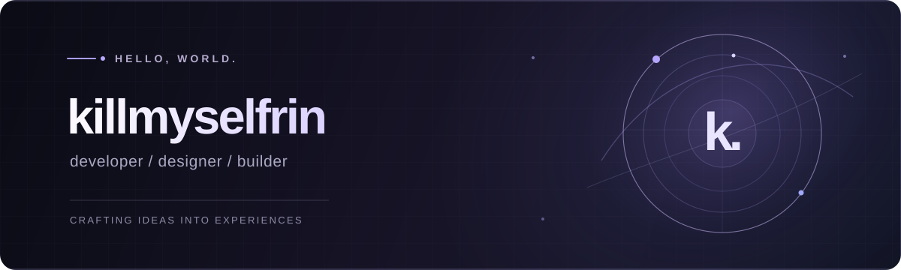

 

<samp>SOFTWARE • DESIGN • CREATIVITY</samp>

  

I like building things that feel considered — not just functional. 
Exploring the space between clean code, thoughtful interfaces and creative ideas.

  

### A little about me

I'm a developer who enjoys experimenting, learning new technologies and turning ideas into something real. I'm particularly interested in **desktop experiences**, **UI/UX**, **automation** and **game development**.

I care about small details: how an interface moves, how a feature feels to use, and how the whole experience comes together.

### Things I enjoy

<table>
<tr>
<td width="33%" valign="top">
<strong>01 / Design</strong>  
Minimal interfaces, calm colors, deliberate typography and subtle motion.
</td>
<td width="33%" valign="top">
<strong>02 / Build</strong>  
Desktop software, interactive tools and experiments that become real projects.
</td>
<td width="33%" valign="top">
<strong>03 / Explore</strong>  
New technologies, creative workflows and ideas that push me to learn.
</td>
</tr>
</table>

### Technologies I explore

`Linux` · `Qt / QML` · `JavaScript` · `TypeScript` · `React` · `Rust` · `Python` · `Git`

---

Less noise. More intention.

Thanks for visiting ✦

